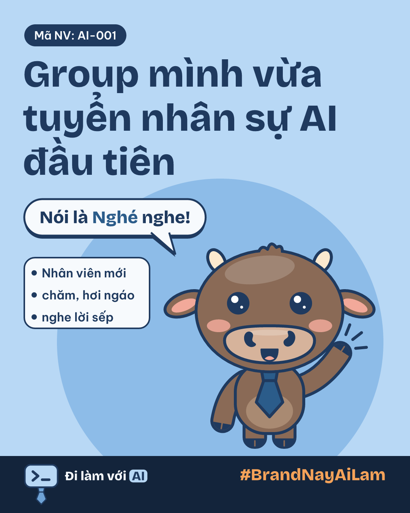
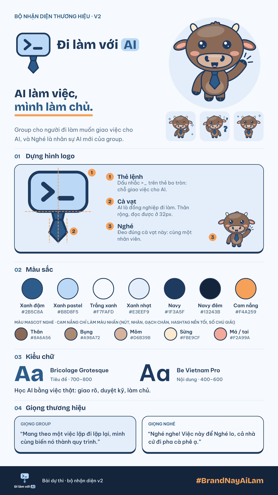

<p align="center">
  
</p>

# Nghé — nhân sự AI mới của Đi làm với AI

**AI làm việc, mình làm chủ.**

Bộ nhận diện cho group **Đi làm với AI**, bài dự thi minigame *#BrandNayAiLam*. Nghé là trâu con, nhân viên mới của group: chăm chỉ, hơi ngáo, giao việc rõ thì "Nghé nghe" liền. Toàn bộ do **Claude Code** làm theo lệnh của một người không biết vẽ.

> **Bản hiện hành là v2** (thư mục [v2](v2/)): Nghé chồi sừng, đeo cà vạt giống logo, thêm màu nhấn cam nắng. Bản đầu (sừng to, đeo thẻ) giữ nguyên ở `01-logo`, `03-mascot`, `board` để đối chiếu.

Bản sao Google Drive (file zip): https://drive.google.com/file/d/1b0NVDBWXCa9yrvcUSXn7C5zqt7OyYLTn/view?usp=sharing

## 6 hạng mục

| # | Hạng mục | Xem ở đâu |
|---|---|---|
| 1 | Logo "thẻ thắt cà vạt, dấu nhắc lệnh": AI là đồng nghiệp cấp cao, mặt là chỗ mình giao việc cho Agent. Bản ngang + dọc (SVG, PNG nền trong suốt; thêm bản 1 màu, nền tối, icon) | [v2/01-logo](v2/01-logo/) |
| 2 | Slogan + lời giải thích | [02-slogan](02-slogan/slogan.md) |
| 3 | Mascot Nghé (chồi sừng, đeo cà vạt), character sheet, 6 sticker. Có thêm bản sừng non ở `v2/03-mascot-sung-non` | [v2/03-mascot](v2/03-mascot/) |
| 4 | Font: Bricolage Grotesque + Be Vietnam Pro | [04-font](04-font/fonts.md) |
| 5 | Brand voice (có câu mẫu) | [05-brand-voice](05-brand-voice/brand-voice.md) |
| 6 | DESIGN.md (HEX, font, cỡ chữ, spacing, bo góc, quy tắc logo) | [DESIGN.md](DESIGN.md) |

Kèm: quy trình làm việc với Agent và ảnh chụp quá trình ở [06-process](06-process/PROCESS.md).

## Brand board



Mockup (thẻ nhân viên, ly cà phê, slide webinar, ảnh bìa group), poster xanh pastel cho ảnh đầu bài đăng (`poster-nghe-xanh.png`) và 5 trang carousel "8 prompt" nằm trong [v2/board](v2/board/). So sánh bản đầu với v2: [v2/so-sanh.png](v2/so-sanh.png).

## Màu

| Tên | HEX | Dùng cho |
|---|---|---|
| Xanh đậm (primary) | `#2B5C8A` | Chữ "AI", nút, dây đeo thẻ, điểm nhấn. Chữ trên nền chính đạt 6.68:1 |
| Xanh pastel (primary-soft) | `#B8D8F5` | Màu chủ đạo: thẻ nhân viên, nền ảnh bìa và poster. Chữ navy trên nền này đạt 7.75:1 |
| Trắng xanh (background) | `#F7FAFD` | Nền chính |
| Xanh nhạt (surface) | `#E3EEF9` | Thẻ, khung nội dung |
| Navy (text) | `#1F3A5F` | Chữ chính, nét viền |
| Navy nhạt (text-muted) | `#4F6B8A` | Chữ phụ |
| Nâu trâu (buffalo) | `#8A6A56` | Thân Nghé (v2; bụng `#A98A72`, mõm `#D6B39B`) |
| Cam nắng (accent) | `#F4A259` | Màu nhấn: nút, gạch chân, số chú giải, hashtag trên nền tối. Không dùng làm chữ trên nền sáng |
| Xanh lá (success) | `#5E8C3A` | Trạng thái "xong rồi sếp" (không dùng làm chữ) |
| Navy đêm (dark-bg) | `#13243B` | Nền tối |

## Font

- Tiêu đề: **Bricolage Grotesque** (700, 800)
- Nội dung: **Be Vietnam Pro** (400, 500, 600)

Cả hai lấy từ [Google Fonts](https://fonts.google.com), có đủ dấu tiếng Việt, giấy phép SIL OFL.

## Copy về làm brand cho chính bạn

Quy trình làm Nghé được viết lại thành **8 prompt điền chỗ trống** (research, phỏng vấn chốt concept, phác logo, mascot, sticker, DESIGN.md, brand board): [06-process/prompts.md](06-process/prompts.md). Thay tên cộng đồng và con vật của bạn vào là chạy được.

Câu chuyện đầy đủ, dòng thời gian và những lỗi review bắt được: [06-process/PROCESS.md](06-process/PROCESS.md).

## Dựng lại từ đầu

Cần Node 24 và Python 3.

```bash
npm install && npm run fonts && npm test && npm run build
```

Lệnh cuối dựng lại bản đầu (SVG, PNG, brand board, GIF) từ code trong `src/`. Kiểm DESIGN.md: `npm run lint:design`.

Dựng lại v2 (chạy từ thư mục gốc repo):

```bash
node v2/src/logo.mjs && node v2/src/mascot.mjs && node v2/src/board.mjs && node v2/src/compare.mjs
```

Bản sừng non: `HORN=sung-non node v2/src/mascot.mjs`.

## Tác giả và giấy phép

Tác giả: DKayden — làm cùng Claude Code.

Bản quyền thiết kế thuộc tác giả; group Đi làm với AI được dùng theo thể lệ minigame. Font: SIL OFL.
