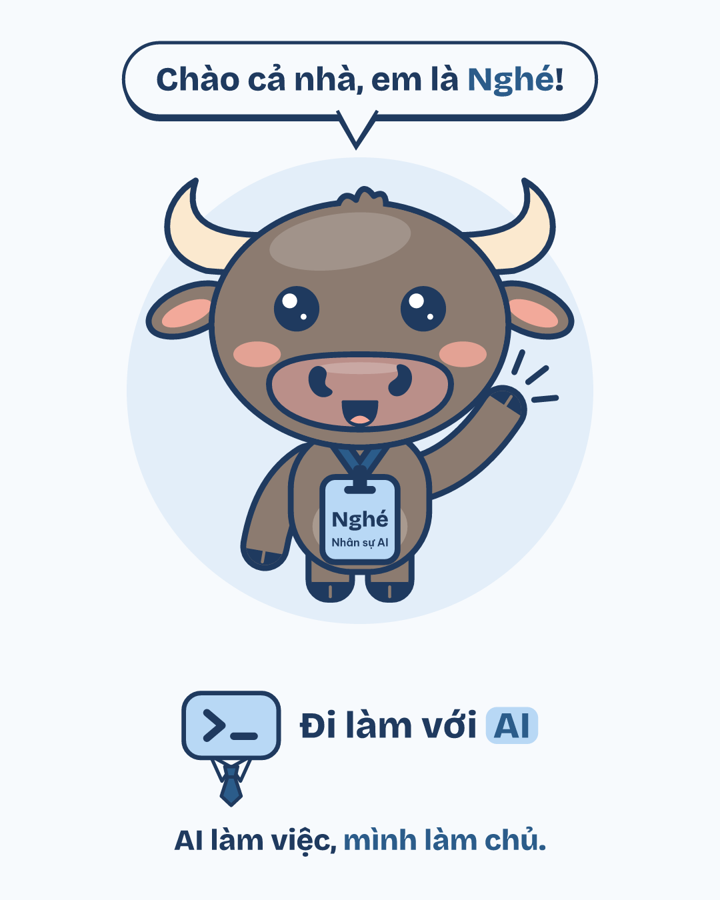
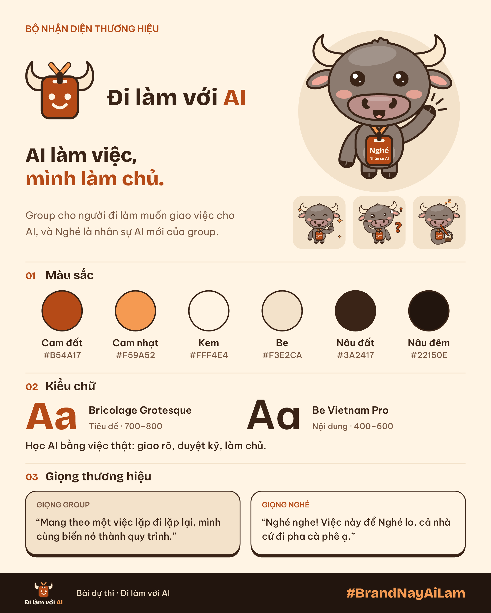

<p align="center">
  
</p>

# Nghé — nhân sự AI mới của Đi làm với AI

**AI làm việc, mình làm chủ.**

Bộ nhận diện cho group **Đi làm với AI**, bài dự thi minigame *#BrandNayAiLam*. Nghé là trâu con, nhân viên mới của group: chăm chỉ, hơi ngáo, giao việc rõ thì "Nghé nghe" liền. Toàn bộ do **Claude Code** làm theo lệnh của một người không biết vẽ.

Bản sao Google Drive: (sẽ cập nhật)

## 6 hạng mục

| # | Hạng mục | Xem ở đâu |
|---|---|---|
| 1 | Logo ngang + dọc (SVG, PNG nền trong suốt; thêm bản 1 màu, nền tối) | [01-logo](01-logo/) |
| 2 | Slogan + lời giải thích | [02-slogan](02-slogan/slogan.md) |
| 3 | Mascot Nghé, character sheet, 6 sticker | [03-mascot](03-mascot/) |
| 4 | Font: Bricolage Grotesque + Be Vietnam Pro | [04-font](04-font/fonts.md) |
| 5 | Brand voice (có câu mẫu) | [05-brand-voice](05-brand-voice/brand-voice.md) |
| 6 | DESIGN.md (HEX, font, cỡ chữ, spacing, bo góc, quy tắc logo) | [DESIGN.md](DESIGN.md) |

Kèm: quy trình làm việc với Agent và ảnh chụp quá trình ở [06-process](06-process/PROCESS.md).

## Brand board



Mockup (thẻ nhân viên, ly cà phê, slide webinar, ảnh bìa group) và GIF nằm trong [board](board/).

## Màu

| Tên | HEX | Dùng cho |
|---|---|---|
| Cam đất (primary) | `#B54A17` | Nút, thẻ nhân viên, điểm nhấn. Chữ trên nền kem đạt 4.88:1 |
| Cam nhạt (primary-soft) | `#F59A52` | Viền, chi tiết phụ |
| Kem (background) | `#FFF4E4` | Nền chính |
| Be (surface) | `#F3E2CA` | Thẻ, khung nội dung |
| Nâu cà phê (text) | `#3A2417` | Chữ chính, nét viền |
| Nâu nhạt (text-muted) | `#7A5A45` | Chữ phụ |
| Xám trâu (buffalo) | `#8C7B70` | Thân Nghé |
| Xanh lá (success) | `#5E8C3A` | Trạng thái "xong rồi sếp" |
| Nâu đậm (dark-bg) | `#22150E` | Nền tối |

## Font

- Tiêu đề: **Bricolage Grotesque** (700, 800)
- Nội dung: **Be Vietnam Pro** (400, 500, 600)

Cả hai lấy từ [Google Fonts](https://fonts.google.com), có đủ dấu tiếng Việt, giấy phép SIL OFL.

## Copy về làm brand cho chính bạn

Quy trình làm Nghé được viết lại thành **8 prompt điền chỗ trống** (research, phỏng vấn chốt concept, phác logo, mascot, sticker, DESIGN.md, brand board): [06-process/prompts.md](06-process/prompts.md). Thay tên cộng đồng và con vật của bạn vào là chạy được.

Câu chuyện đầy đủ, dòng thời gian và những lỗi review bắt được: [06-process/PROCESS.md](06-process/PROCESS.md).

## Dựng lại từ đầu

Cần Node 24 và Python 3.

```bash
npm install && npm run fonts && npm test && npm run build
```

Lệnh cuối dựng lại toàn bộ SVG, PNG, brand board và GIF từ code trong `src/`. Kiểm DESIGN.md: `npm run lint:design`.

## Tác giả và giấy phép

Tác giả: DKayden — làm cùng Claude Code.

Bản quyền thiết kế thuộc tác giả; group Đi làm với AI được dùng theo thể lệ minigame. Font: SIL OFL.
